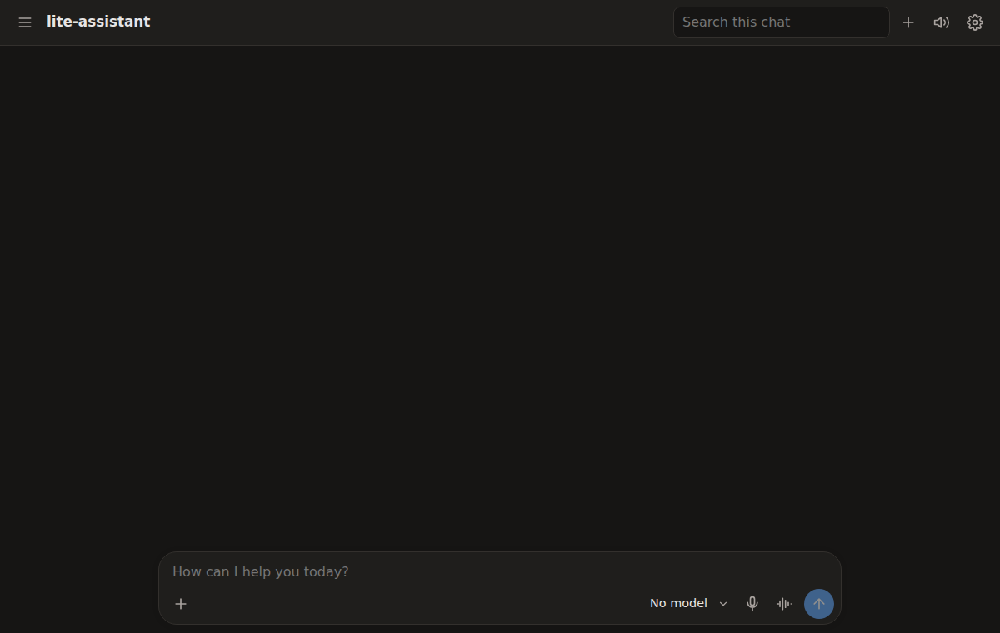

lite-assistant is a local, OpenAI-compatible voice and chat server for your own machine: it chats with Gemma on-device, speaks with Kokoro, transcribes with Moonshine, and sees, hears and measures photos and sound, for any OpenAI client or a board on your network.

## Install

```bash
git clone https://github.com/bdbarnett/lite-assistant
cd lite-assistant
pip install -e .
lite-assistant setup     # downloads the models, about 8.5 GB
lite-assistant serve     # listens on 0.0.0.0:5000
```

`run.sh` (or `run.cmd` on Windows) does all three in a `.venv`.

## Try it

```bash
curl http://localhost:5000/v1/audio/speech \
  -H 'Content-Type: application/json' \
  -d '{"model": "kokoro", "input": "Hello world!", "voice": "af_heart"}' > hello.raw
```

`hello.raw` is raw 16-bit, 24 kHz mono PCM: about 56 KB, 1.2 seconds of speech. Play it with `ffplay -f s16le -ar 24000 -ac 1 hello.raw`.

[Docs](docs/index.md) | [Examples](examples) | [Roadmap](ROADMAP.md)

Made by [PyDevices](https://pydevices.com).
